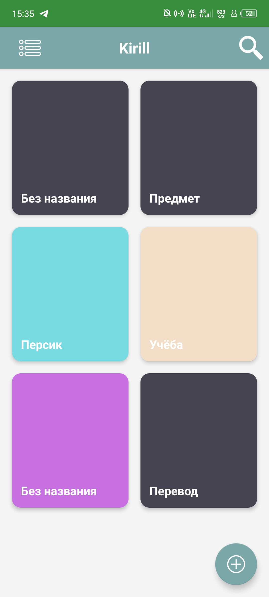
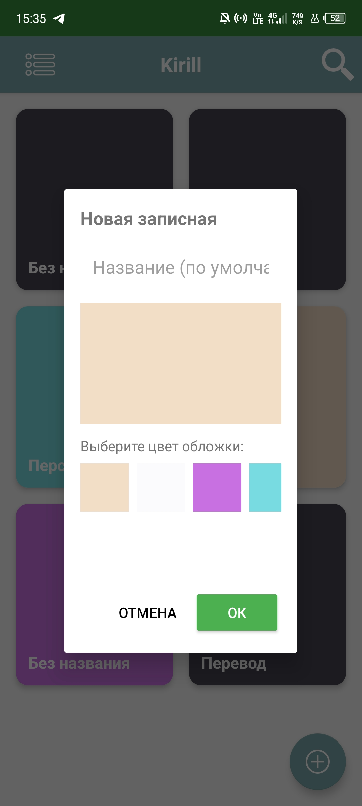
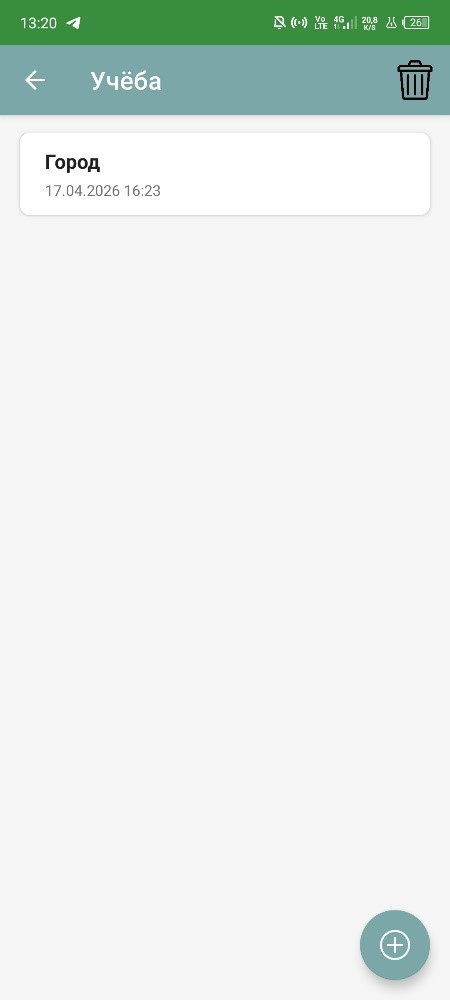
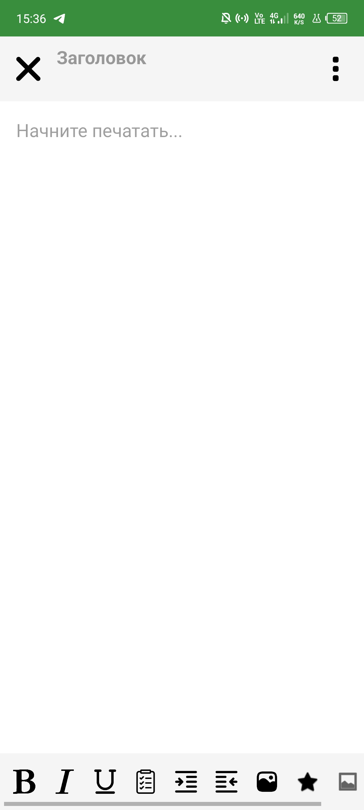
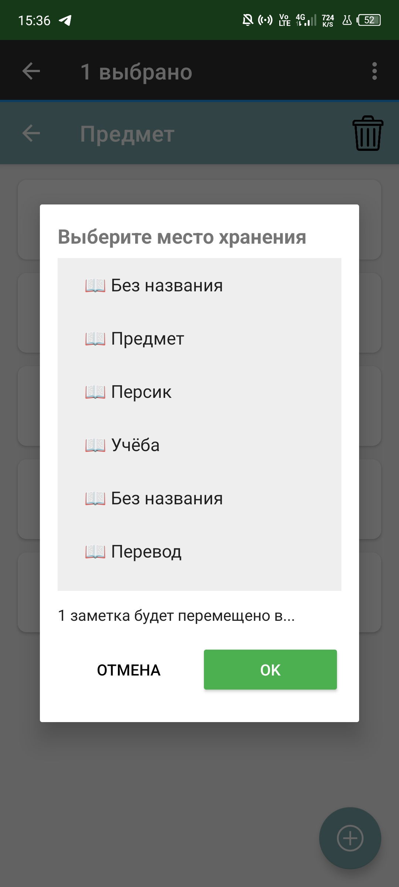
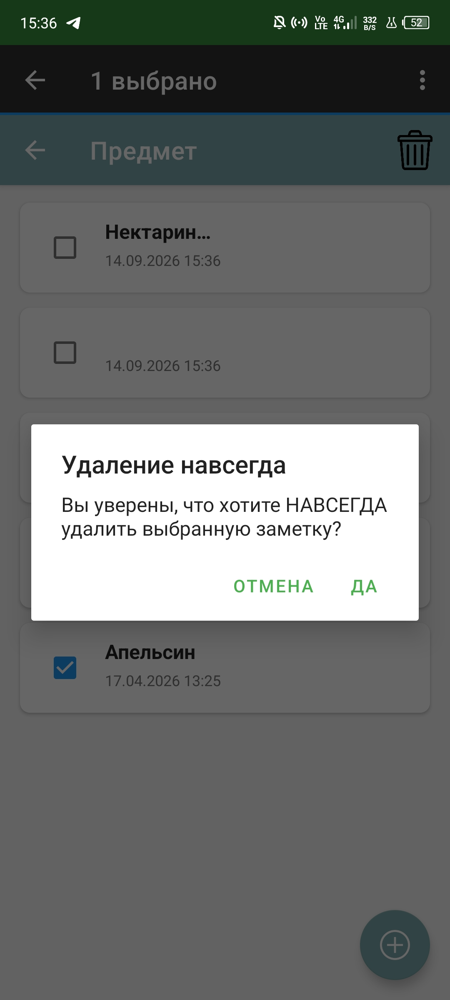
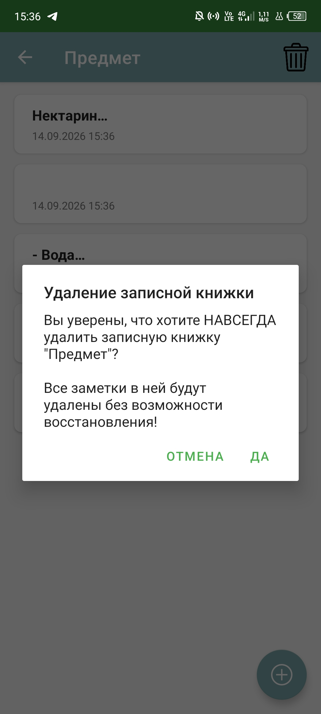

# Руководство пользователя

**Разделы документации:**
[Главная](index.md) | [Введение](01-intro.md) | [Пользователю](02-user-guide.md) | [Администратору](03-admin-guide.md) | [Разработчику](04-developer-guide.md) | [Справочник и FAQ](05-reference.md)

---

## Введение
Этот раздел предназначен для пользователей мобильного приложения **Kirill**. Здесь описано, как выполнять основные операции: создавать записные книжки, добавлять и редактировать заметки, перемещать их и удалять.

## Запуск приложения

**Действие:** Найдите значок приложения «Kirill» на главном экране или в меню приложений и нажмите на него.

**Ожидаемый результат:** Откроется главный экран приложения со списком существующих записных книжек. Если записных книжек нет, отобразится пустой список и кнопка «Создать записную книжку».

## Создание новой записной книжки

1. На главном экране нажмите кнопку **«+»** в правом нижнем углу.
2. В открывшемся окне введите название записной книжки (например, «Работа»).
3. Выберите цвет обложки (опционально).
4. Нажмите кнопку **«OK»**.

**Ожидаемый результат:** Новая записная книжка появится в списке на главном экране.

## Создание новой заметки

1. На главном экране нажмите на нужную записную книжку.
2. Внутри книжки нажмите кнопку **«+»** в правом нижнем углу.
3. Введите заголовок и текст заметки.
4. Нажмите кнопку **«Закрыть»** (крестик). Заметка сохранится автоматически.

**Ожидаемый результат:** Заметка отобразится в списке внутри записной книжки.

## Редактирование заметки

1. Откройте записную книжку и нажмите на нужную заметку.
2. Внесите изменения в заголовок или текст.
3. Нажмите **«Закрыть»**.

**Ожидаемый результат:** Изменения сохранятся, при возврате в список отобразится обновлённый текст.

## Перемещение заметки между записными книжками

1. Нажмите и удерживайте заметку до появления меню.
2. Выберите пункт **«Переместить»**.
3. В открывшемся списке выберите нужную записную книжку.
4. Нажмите **«OK»**.

**Ожидаемый результат:** Заметка исчезнет из текущей книжки и появится в выбранной.

## Удаление заметки

1. Нажмите и удерживайте заметку.
2. В верхней панели нажмите на три точки (меню) и выберите **«Удалить»**.
3. Подтвердите удаление кнопкой **«Да»**.

**Ожидаемый результат:** Заметка удалится без возможности восстановления.

## Удаление записной книжки

1. Зайдите в записную книжку.
2. Нажмите на иконку мусорной корзины в верхнем правом углу.
3. Подтвердите удаление.

**Ожидаемый результат:** Записная книжка и все заметки внутри неё удалятся.

## Завершение работы

Нажмите системную кнопку «Домой» или «Назад». Для полного закрытия откройте меню запущенных приложений и смахните «Kirill».

**Ожидаемый результат:** Приложение закроется, все данные сохранятся автоматически.

---
[← Вернуться на главную](index.md)
