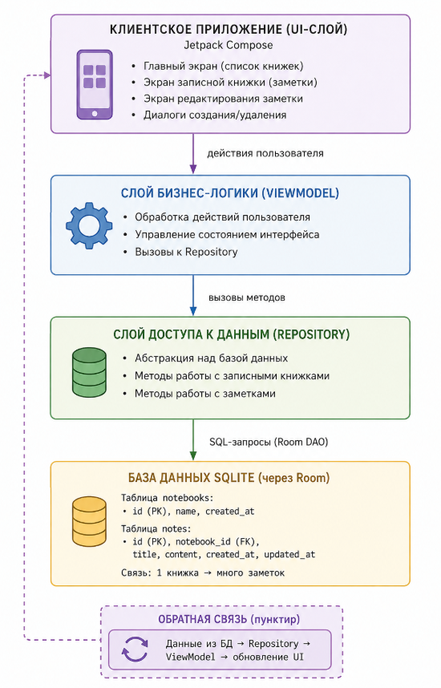

# Руководство администратора

**Разделы документации:**
[Главная](index.md) | [Введение](01-intro.md) | [Пользователю](02-user-guide.md) | [Администратору](03-admin-guide.md) | [Разработчику](04-developer-guide.md) | [Справочник и FAQ](05-reference.md)

---

## Общие сведения о программе
Приложение **Kirill** работает автономно. С точки зрения администратора, ключевыми задачами являются проверка целостности базы данных, контроль свободного места и обновление приложения.

### Структура программы
Программа состоит из UI-слоя (Jetpack Compose), ViewModel, Repository и базы данных SQLite. Все данные хранятся локально.

## Настройка программы

Параметры настройки задаются при сборке приложения в файле `build.gradle`:

| Параметр | Назначение | Пример |
| :--- | :--- | :--- |
| `DATABASE_NAME` | Имя файла БД | `kirill_notes.db` |
| `LOG_LEVEL` | Уровень логирования | `DEBUG` / `INFO` / `ERROR` |
| `MAX_NOTEBOOKS` | Максимум книжек | `100` |

## Проверка программы (диагностика)

Для проверки используется Android Debug Bridge (ADB).

- **Проверка БД:** `adb shell "run-as com.example.kirill ls /data/data/com.example.kirill/databases/"`
  *(Ожидается наличие файла `kirill_notes.db`)*
- **Проверка заметок:** `adb shell "run-as com.example.kirill sqlite3 /data/data/com.example.kirill/databases/kirill_notes.db 'SELECT * FROM notes;'"`
- **Проверка памяти:** `adb shell dumpsys meminfo com.example.kirill` *(Норма: до 150 МБ)*

## Техническое обслуживание

### Ежедневные проверки
- Запуск приложения (главный экран загружается).
- Проверка свободного места (не менее 100 МБ).
- Создание тестовой заметки (сохраняется без ошибок).

### Еженедельные проверки
- Просмотр списка книжек (все на месте).
- Проверка логов через `adb logcat -d | grep -i "Kirill"` (ошибок нет).
- Тестовое восстановление резервной копии.

### Ежемесячные проверки
- Замер времени открытия заметки (не более 100 мс).
- Проверка размера логов (не более 10 МБ).

## Действия при неисправностях

| Признак | Причина | Действие |
| :--- | :--- | :--- |
| Приложение не запускается | Поврежден APK | Переустановить |
| Заметки не сохраняются | Повреждена БД | Проверить права, пересоздать БД |
| Свободное место < 100 МБ | Мусор | Очистить кэш/копии |

**Эскалация:** Если проблема не решена за 30 минут, требуется восстановление БД или есть признаки потери данных — обратитесь к разработчику.

---
[← Вернуться на главную](index.md)
