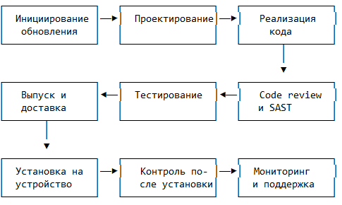

# Руководство разработчика

**Разделы документации:**
[Главная](index.md) | [Введение](01-intro.md) | [Пользователю](02-user-guide.md) | [Администратору](03-admin-guide.md) | [Разработчику](04-developer-guide.md) | [Справочник и FAQ](05-reference.md)

---

## Назначение и условия применения программы

Программный интерфейс (API) приложения **Kirill** предназначен для предоставления разработчику набора методов работы с заметками и записными книжками. Интерфейс реализован в виде слоя репозиториев (Repository) на языке Kotlin и позволяет выполнять операции создания, чтения, обновления, удаления и перемещения данных без обращения к пользовательскому интерфейсу.

### Функции программы

Программный интерфейс предоставляет следующие функции:

- создание новой записной книжки;
- получение списка всех записных книжек;
- переименование записной книжки;
- удаление записной книжки вместе со всеми заметками;
- создание новой заметки внутри записной книжки;
- получение списка заметок в записной книжке;
- получение заметки по идентификатору;
- редактирование заголовка и текста заметки;
- удаление заметки;
- перемещение заметки из одной записной книжки в другую.

### Условия, необходимые для выполнения программы

- **Оперативная память:** не менее 512 МБ для процесса приложения.
- **Программное обеспечение:** Android 12 (S) или выше, Kotlin 1.9+, Android SDK 33+.
- **Доступ к базе данных** SQLite через Room DAO.

---

## Характеристики программы

### Временные характеристики

- Время выполнения операции чтения (SELECT): не более 20 мс.
- Время выполнения операции записи (INSERT/UPDATE/DELETE): не более 50 мс.
- Время перемещения заметки между записными книжками: не более 80 мс.

### Режим работы

Программный интерфейс работает в **асинхронном режиме**. Все методы репозиториев объявлены как `suspend`-функции и должны вызываться из корутин (`CoroutineScope`). Это обеспечивает неблокирующую работу с базой данных и не мешает работе пользовательского интерфейса.

### Средства контроля правильности выполнения

- **Валидация входных данных:** проверка на пустые строки, корректность идентификаторов.
- **Обработка ошибок:** методы выбрасывают исключения (`IllegalArgumentException`, `NoSuchElementException`) с описанием причины.
- **Логирование:** все операции записываются в Logcat с тегом `KirillRepository`.

---

## Обращение к программе

### Способ вызова

Программный интерфейс реализован в виде **Repository-классов** на Kotlin. Обращение происходит через методы, объявленные как `suspend`-функции. Для получения экземпляра репозитория используется внедрение зависимостей (Hilt) или прямое создание через `Application`-класс.

```kotlin
val notebookRepo: NotebookRepository = app.container.notebookRepository
val noteRepo: NoteRepository = app.container.noteRepository
```

### Передача параметров

Параметры передаются напрямую в методы репозитория в виде аргументов Kotlin-функций. Для операций создания и обновления используются **data-классы**.

```kotlin
data class Notebook(
    val id: Long = 0,
    val name: String,
    val createdAt: Long = System.currentTimeMillis()
)

data class Note(
    val id: Long = 0,
    val notebookId: Long,
    val title: String,
    val content: String,
    val createdAt: Long = System.currentTimeMillis(),
    val updatedAt: Long = System.currentTimeMillis()
)
```

### Пример вызова — создание записной книжки

```kotlin
val notebook = Notebook(name = "Работа")
val newId = notebookRepo.createNotebook(notebook)
// newId — идентификатор созданной записной книжки (Long)
```

### Пример вызова — получение списка заметок

```kotlin
val notes: List<Note> = noteRepo.getNotesByNotebook(notebookId = 1L)
```

### Пример вызова — перемещение заметки

```kotlin
noteRepo.moveNote(noteId = 5L, targetNotebookId = 3L)
```

### Формат ответа

Методы возвращают:

- `Long` — идентификатор созданной записи;
- `List<Notebook>` или `List<Note>` — списки объектов;
- `Notebook?` или `Note?` — объект или `null`, если не найден;
- `Unit` — для операций обновления и удаления.

---

## Входные и выходные данные

### Входные данные

#### Метод: `createNotebook(notebook: Notebook): Long`

| Поле | Тип | Обязательное | Описание |
| :--- | :--- | :--- | :--- |
| `name` | String | Да | Название записной книжки (не пустое) |
| `createdAt` | Long | Нет | Время создания (по умолчанию — текущее) |

#### Метод: `createNote(note: Note): Long`

| Поле | Тип | Обязательное | Описание |
| :--- | :--- | :--- | :--- |
| `notebookId` | Long | Да | Идентификатор записной книжки |
| `title` | String | Да | Заголовок заметки (не пустой) |
| `content` | String | Да | Текст заметки |
| `createdAt` | Long | Нет | Время создания |
| `updatedAt` | Long | Нет | Время последнего изменения |

#### Метод: `moveNote(noteId: Long, targetNotebookId: Long)`

| Поле | Тип | Обязательное | Описание |
| :--- | :--- | :--- | :--- |
| `noteId` | Long | Да | Идентификатор перемещаемой заметки |
| `targetNotebookId` | Long | Да | Идентификатор целевой записной книжки |

### Выходные данные

#### Метод: `getAllNotebooks(): List<Notebook>`

| Поле | Тип | Описание |
| :--- | :--- | :--- |
| `id` | Long | Уникальный идентификатор записной книжки |
| `name` | String | Название записной книжки |
| `createdAt` | Long | Время создания |

#### Метод: `getNoteById(noteId: Long): Note?`

| Поле | Тип | Описание |
| :--- | :--- | :--- |
| `id` | Long | Уникальный идентификатор заметки |
| `notebookId` | Long | Идентификатор записной книжки |
| `title` | String | Заголовок заметки |
| `content` | String | Текст заметки |
| `createdAt` | Long | Время создания |
| `updatedAt` | Long | Время последнего изменения |

### Кодирование

Все строковые данные передаются в кодировке **UTF-8**. Даты хранятся в формате **Unix Timestamp** (количество миллисекунд с 1 января 1970 года).

---

## Сообщения

В ходе выполнения операций программный интерфейс может выдавать следующие сообщения (исключения):

| Текст сообщения | Содержание | Действия программиста |
| :--- | :--- | :--- |
| `IllegalArgumentException: Notebook name cannot be empty` | Название записной книжки пустое | Проверить входное поле `name` |
| `IllegalArgumentException: Note title cannot be empty` | Заголовок заметки пустой | Проверить поле `title` |
| `NoSuchElementException: Notebook with id=X not found` | Записная книжка не найдена | Проверить `notebookId` |
| `NoSuchElementException: Note with id=X not found` | Заметка не найдена | Проверить `noteId` |
| `IllegalStateException: Cannot move note to the same notebook` | Перемещение в ту же книжку | Убедиться, что ID отличаются |
| `SQLiteException: database is locked` | База данных заблокирована | Повторить операцию |
| `SQLiteException: disk I/O error` | Ошибка ввода-вывода | Проверить место, перезапустить |
| `OutOfMemoryError: failed to allocate` | Недостаточно памяти | Уменьшить данные, проверить утечки |

---

## Процесс обновления приложения

Обновления выпускаются в соответствии с регламентом (ГОСТ Р 56939-2024 и методический документ ЦБ РФ).

### Этапы процесса

1. **Инициирование обновления:** создание задачи, определение типа обновления (функциональное, безопасности, зависимостей).
2. **Разработка:** написание кода, code review, статический анализ (SAST).
3. **Тестирование:** функциональное, регрессионное, тестирование безопасности (DAST, фаззинг, тестирование на проникновение).
4. **Сборка и выпуск:** сборка APK, подпись цифровой подписью, расчёт контрольной суммы SHA-256.
5. **Доставка:** публикация в Google Play или внутреннем портале, уведомление пользователей.
6. **Мониторинг:** отслеживание обращений, уязвимостей, анализ логов.

Схема полного процесса обновления приведена ниже.



### Артефакты обновления

Для каждого обновления формируются:

- **Release notes** — описание изменений.
- **Протокол тестирования** — результаты проверок.
- **Отчёт SAST/DAST** — анализ безопасности.
- **SBOM-перечень** — список зависимостей.
- **Контрольная сумма APK** — для проверки целостности.

---

[← Вернуться на главную](index.md)

**Разделы документации:**
[Главная](index.md) | [Введение](01-intro.md) | [Пользователю](02-user-guide.md) | [Администратору](03-admin-guide.md) | [Разработчику](04-developer-guide.md) | [Справочник и FAQ](05-reference.md)
